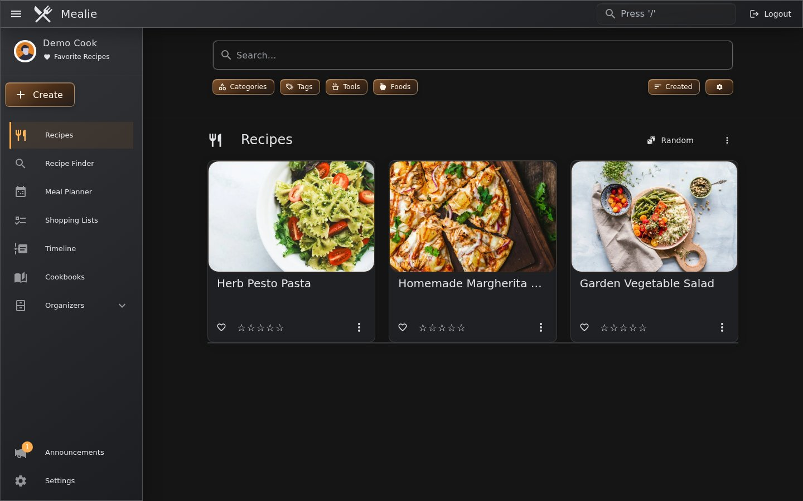
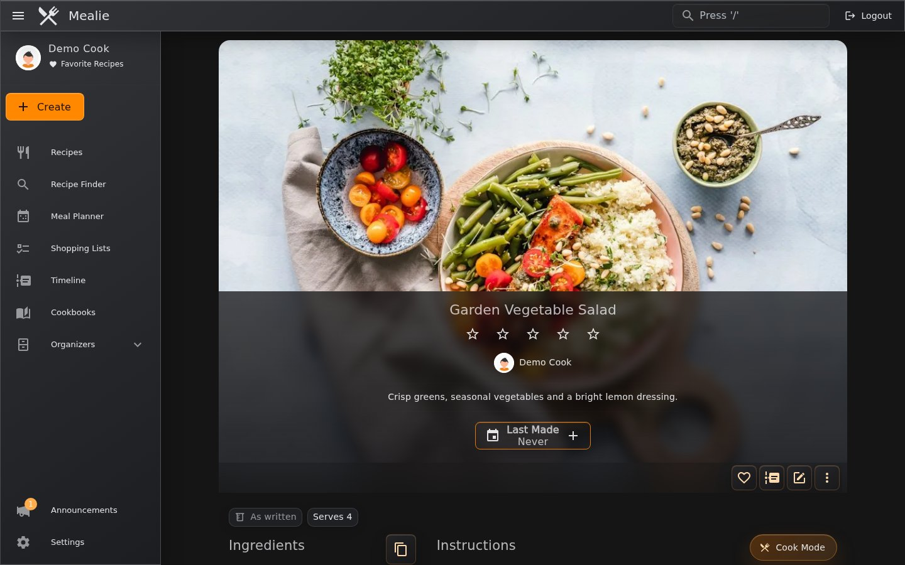
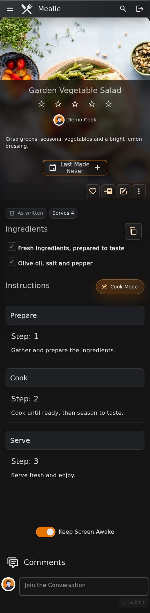

# Mealie Liquid Glass Theme

A dark **Liquid Glass** custom theme for [Mealie](https://github.com/mealie-recipes/mealie):
neutral charcoal content surfaces, orange accents, and translucent navigation
and controls with softened borders.

This fork of [thorethy1/mealie-liquid-glass-theme](https://github.com/thorethy1/mealie-liquid-glass-theme)
includes refinements for navigation, search, menus, switches, checkboxes, admin
pages, cookbooks, organizers, the meal planner, timeline, and recipe pages. It
is the source of the theme used by the server configuration; the upstream
installation instructions below still apply.
Visual direction is inspired by [VLC Redesign](https://github.com/KuchiSofts/vlc-redesign).
The material follows [Apple's guidance on Liquid Glass](https://developer.apple.com/design/human-interface-guidelines/materials):
floating controls use one regular-glass layer while content stays quiet and
readable. This is a CSS approximation, not native optical refraction. Reduced
transparency, increased contrast, reduced motion, and forced-colors preferences
have accessible fallbacks.

Recipe cards use centered image crops; open a recipe and click its photo to
view the complete image in Mealie's lightbox.
Recipe categories, tags, and nutrition use flat sections on desktop and mobile.
Switches use a simple outlined track; checkboxes use an orange flip-disc
treatment inspired by Uiverse.io's chase2k25.

## Screenshots

Captured from Mealie 3.31.0 with the current theme and sample recipes in an
isolated demo instance. No personal data is shown.

**Recipe collection**



**Recipe details**



**Mobile recipe**



Sample food photography from Unsplash:
[salad](https://images.unsplash.com/photo-1547592180-85f173990554),
[pizza](https://images.unsplash.com/photo-1565299624946-b28f40a0ae38),
and [pasta](https://images.unsplash.com/photo-1473093295043-cdd812d0e601).

## Files

- `liquid-glass.css` — the custom frontend stylesheet.
- `entrypoint-liquid-glass.py` — Python injector: auto-discovers Mealie's frontend
  directory, injects the CSS link into every HTML file, computes a content-based
  cache-bust token, then hands off to Mealie's own entrypoint.
- `entrypoint-liquid-glass.sh` — a 4-line shell wrapper that exec's the Python
  injector. Kept as the documented entrypoint so the mount path stays simple.
- `docker-compose.example.yml` — minimal compose snippet showing how to mount
  and enable the theme.

## Quick start (Docker Compose)

Clone this fork, then create a `theme/` directory next to your
`docker-compose.yml` and copy the two entrypoint files plus the CSS into it:

```bash
mkdir -p theme
cp liquid-glass.css theme/liquid-glass.css
cp entrypoint-liquid-glass.py theme/entrypoint-liquid-glass.py
cp entrypoint-liquid-glass.sh theme/entrypoint-liquid-glass.sh
chmod +x theme/entrypoint-liquid-glass.sh theme/entrypoint-liquid-glass.py
```

Add the entrypoint and three volume mounts to your Mealie service:

```yaml
services:
  mealie:
    image: ghcr.io/mealie-recipes/mealie:latest   # or pin to a known tag
    container_name: mealie
    restart: unless-stopped
    entrypoint: ["/theme/entrypoint-liquid-glass.sh"]
    volumes:
      - ./data:/app/data
      - ./theme/liquid-glass.css:/theme/liquid-glass.css:ro
      - ./theme/entrypoint-liquid-glass.sh:/theme/entrypoint-liquid-glass.sh:ro
      - ./theme/entrypoint-liquid-glass.py:/theme/entrypoint-liquid-glass.py:ro
    ports:
      - "9000:9000"
```

Then restart:

```bash
docker compose up -d
```

That's it — no Python version-specific paths, no manual cache-bust bumps.

## What the injector does

1. **Auto-detects Mealie's frontend directory.** It searches, in order:
   - the `STATIC_FILES` env var (used by some packaged installs)
   - the running interpreter's `site-packages` (always correct inside the
     container)
   - common venv layouts under `/opt/mealie/lib/python*/site-packages/mealie/frontend`
2. **Copies `liquid-glass.css` next to the frontend's `index.html`** so Mealie's
   static-file server can serve it at `/liquid-glass.css`.
3. **Strips every previously injected link** (including legacy date-stamped
   ones from older versions of this theme) and injects a fresh one into every
   HTML file:

   ```html
   <link rel="stylesheet" href="/liquid-glass.css?v=<md5-of-css>" id="liquid-glass-theme">
   ```

4. **Hands off** to `/app/run.sh` (Mealie's own entrypoint) with `execvp`,
   replacing the injector process so signals reach Mealie.

## Cache busting

The `?v=` suffix is the first 10 hex chars of the md5 of the CSS file contents.
Whenever you edit `liquid-glass.css`, every Mealie HTML file gets a new link
with a new token on the next container start — no manual bumping required.

## Optional: align Mealie's theme variables

The CSS does most of the visual work. Set these env vars on the Mealie service
to keep Vuetify's runtime colors consistent with the theme:

```env
THEME_LIGHT_PRIMARY="#E87500"
THEME_LIGHT_ACCENT="#FFAD4D"
THEME_LIGHT_SECONDARY="#1F2937"
THEME_LIGHT_SUCCESS="#22C55E"
THEME_LIGHT_INFO="#94A3B8"
THEME_LIGHT_WARNING="#F59E0B"
THEME_LIGHT_ERROR="#F43F5E"
THEME_DARK_PRIMARY="#E87500"
THEME_DARK_ACCENT="#FFAD4D"
THEME_DARK_SECONDARY="#030712"
THEME_DARK_SUCCESS="#22C55E"
THEME_DARK_INFO="#94A3B8"
THEME_DARK_WARNING="#F59E0B"
THEME_DARK_ERROR="#FB7185"
```

## Compatibility

- **Verified:** Mealie 3.31.0 frontend. The original upstream theme was tested
  against Mealie 3.17.x; newer releases may change the HTML targeted by the CSS.
- **Python version**: the injector picks up any `python3.*` under the venv, so
  it survives Python-version bumps inside the container.
- **Mealie's frontend layout**: as long as `mealie/frontend/index.html` exists
  somewhere inside the container (the default wheel layout), the injector
  finds it. If Mealie ever ships pre-bundled static files at a totally new
  path, set `STATIC_FILES=/that/path` and it'll use that.
- **Writable frontend:** the Docker injector must be able to copy the CSS and
  update HTML files in the detected frontend directory. For a read-only frontend,
  inject the stylesheet during the image or package build instead.

## Troubleshooting

- **Theme not applied**: check `docker logs mealie` for lines prefixed with
  `[liquid-glass]`. A `WARNING: could not locate Mealie's frontend dir`
  usually means a non-standard install — try setting `STATIC_FILES`.
- **Old, cached theme in the browser**: hard-reload (Ctrl+Shift+R). The
  md5-based `?v=` should keep this from being needed across restarts, but a
  stale Service Worker (Mealie ships a PWA) can ignore it.
- **Silence the injector logs** for a tidier startup: set
  `LIQUID_GLASS_LOG=0`.

## Notes

- The injector runs inside the container at startup, then replaces itself with
  Mealie's entrypoint; it does not stay resident.
- The CSS, Python injector, and shell wrapper must all be mounted into the
  container for the Docker Compose installation above.
